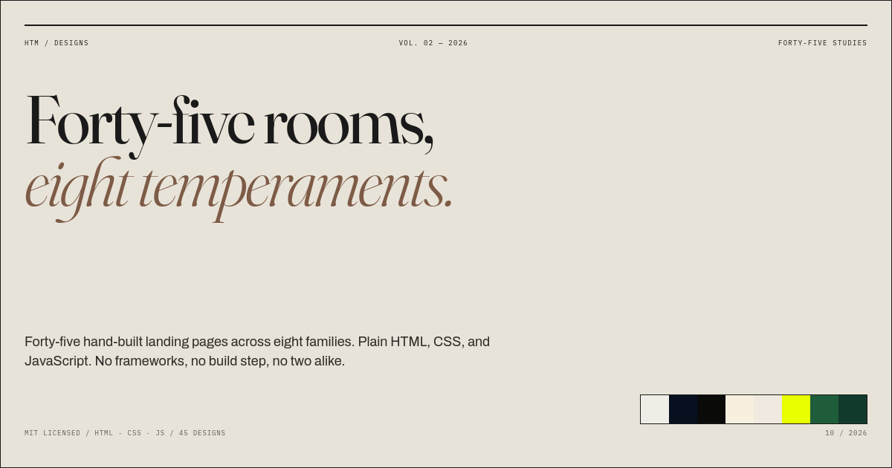

# Landing Page Atlas

**36 hand-built landing pages. Six families. Plain HTML, CSS, and JavaScript.**

[](https://slopmanufacturer.github.io/landing-page-atlas/)
[](https://github.com/slopmanufacturer/landing-page-atlas/generate)
[](LICENSE)
[](#)

[](https://slopmanufacturer.github.io/landing-page-atlas/)

**Live site:** <https://slopmanufacturer.github.io/landing-page-atlas/>

This is a collection of landing pages you can actually open, read, copy, and change. Every page is a separate folder with its own HTML, CSS, and JavaScript. There is no build step, no package manager, and no shared stylesheet holding it all together.

## Start here

- **Browse the catalogue:** [index.html](index.html) — filter by family, open any page.
- **Read the FAQ:** [index.html#faq](index.html#faq) — build steps, reuse, licensing.
- **Use this template:** [github.com/slopmanufacturer/landing-page-atlas/generate](https://github.com/slopmanufacturer/landing-page-atlas/generate)
- **Clone it:**

```sh
git clone https://github.com/slopmanufacturer/landing-page-atlas.git
cd landing-page-atlas
python3 -m http.server 8000
```

Then open <http://localhost:8000>.

## What's inside

Six families, six pages each. They share a mood, not a stylesheet.

| Family | Temperament | The six |
|--------|-------------|---------|
| **Editorial** | Newspapers, journals, catalogues. Serif headlines, hairline rules, dense columns. | [Atelier Nord](designs/01-atelier-nord/index.html) · [The Sunday Review](designs/07-sunday-review/index.html) · [Marrow](designs/08-marrow/index.html) · [Biennale 04](designs/09-biennale-04/index.html) · [Field Notes](designs/10-field-notes/index.html) · [The Long Table](designs/11-long-table/index.html) |
| **Interface** | Instruments and consoles. Monospace data, dark panels, live-looking readouts. | [Meridian](designs/02-meridian/index.html) · [Aster](designs/12-aster/index.html) · [Tidewatch](designs/13-tidewatch/index.html) · [Signal 88.4](designs/14-signal/index.html) · [Grid](designs/15-grid/index.html) · [Relay](designs/16-relay/index.html) |
| **Luxury** | Jewellery, hotels, couture. High contrast, wide margins, almost no motion. | [Maison Noir](designs/03-maison-noir/index.html) · [Aurelia](designs/17-aurelia/index.html) · [Hôtel Cendres](designs/18-hotel-cendres/index.html) · [Vantage](designs/19-vantage/index.html) · [Cuvée 9](designs/20-cuvee-9/index.html) · [Atelier Lune](designs/21-atelier-lune/index.html) |
| **Print** | Riso, zines, record shops. Flat inks, hard edges, poster-scale type. | [Wave Pool](designs/04-wave-pool/index.html) · [Static Club](designs/22-static-club/index.html) · [Dog Ear Books](designs/23-dog-ear-books/index.html) · [Kickflip](designs/24-kickflip/index.html) · [Laugh Track](designs/25-laugh-track/index.html) · [Press Room](designs/26-press-room/index.html) |
| **Minimal** | Ceramics, tea, quiet rooms. Few elements, soft palettes, a lot of air. | [Kōan](designs/05-koan/index.html) · [Clay & Co.](designs/27-clay-and-co/index.html) · [Still](designs/28-still/index.html) · [Northbound](designs/29-northbound/index.html) · [Sōma](designs/30-soma/index.html) · [The Quiet Room](designs/31-quiet-room/index.html) |
| **Industrial** | Tools, audio, hardware. Stencil type, hazard yellow, exposed structure. | [Hydra Works](designs/06-hydra-works/index.html) · [Forge](designs/32-forge/index.html) · [Apex](designs/33-apex/index.html) · [Bolt](designs/34-bolt/index.html) · [Tape Deck](designs/35-tape-deck/index.html) · [Foundry](designs/36-foundry/index.html) |

## What you get

- 36 complete landing pages, each with its own layout, type, palette, and interaction.
- Six distinct directions: newspaper, satellite console, perfume house, riso festival, tea room, synth datasheet, and thirty more.
- No frameworks, bundlers, analytics, cookies, or third-party scripts.
- Responsive layouts tested at 1440, 768, 390, and 320 px.
- Keyboard-operable controls, labelled forms, and `prefers-reduced-motion` support.
- Google Fonts with system fallbacks. The pages still work if the fonts do not load.
- A gallery page with a filterable catalogue, one-click source copy, quick start, and FAQ.
- MIT licence. Personal, commercial, modification, redistribution: all fine.

## How to use one page

1. Open the folder you want under `designs/`.
2. Copy `index.html`, `style.css`, and `script.js` into your project.
3. Change the CSS variables, the fonts, and the copy.
4. Delete anything you do not need. There is no shared code to break.

The gallery is optional. Every design folder works on its own.

## Why 36?

Six families with six different problems is a better test of range than six pages that all look the same. The brief for each page was different. The only shared rule was that nothing should look like a template.

## Structure

```text
.
├── index.html              # Showcase, catalogue, and FAQ
├── style.css               # Showcase only
├── script.js               # Catalogue filters, copy button, FAQ
├── assets/
│   ├── favicon.svg
│   ├── og.png              # Social preview
│   └── thumbs/             # 36 gallery screenshots
├── designs/
│   ├── 01-atelier-nord/
│   ├── 02-meridian/
│   ├── ...
│   └── 36-foundry/
├── CONTRIBUTING.md         # how to add a family
├── LICENSE
└── README.md
```

## A note on the fonts

The pages load Google Fonts. If you are offline, or the network blocks them, the system fallbacks take over. Nothing breaks. If you want a fully self-hosted build, download the font files and replace the `<link>` tags in each page.

## Contributing

New families are the point. If you have six pages that belong together, read
[CONTRIBUTING.md](CONTRIBUTING.md). Fixes to existing pages are just as welcome.

## Licence

[MIT](LICENSE). Use it for personal or commercial work. Modify it, redistribute it, sell it. Keep the copyright notice.

The brands, people, products, and addresses inside the designs are fictional.
